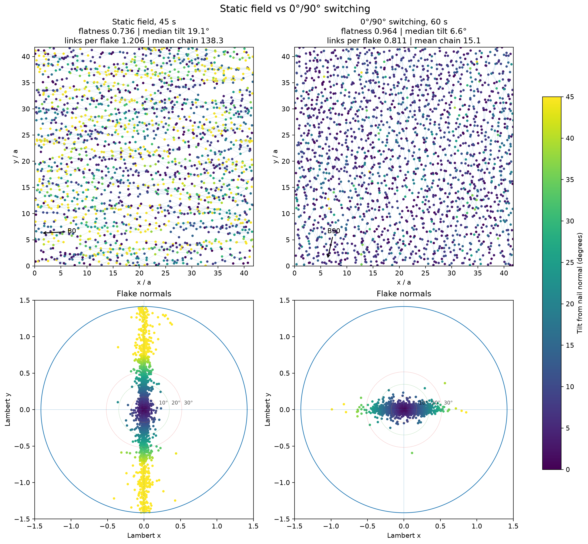
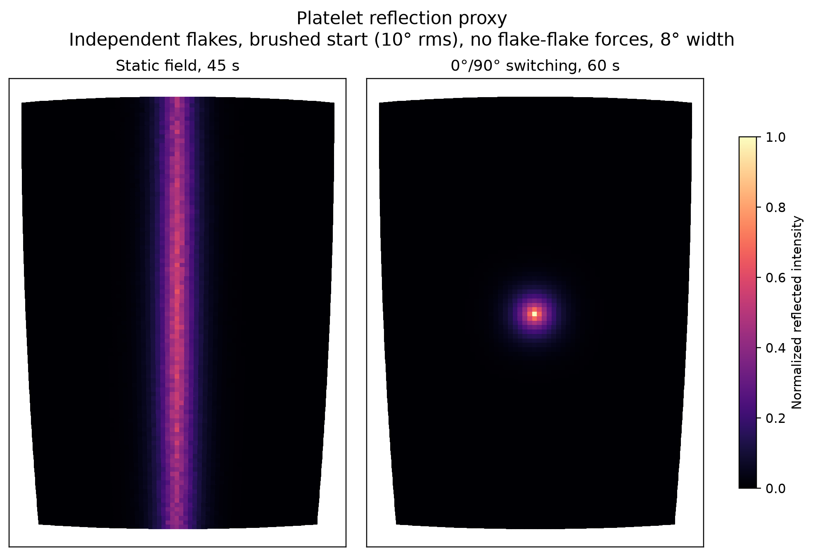
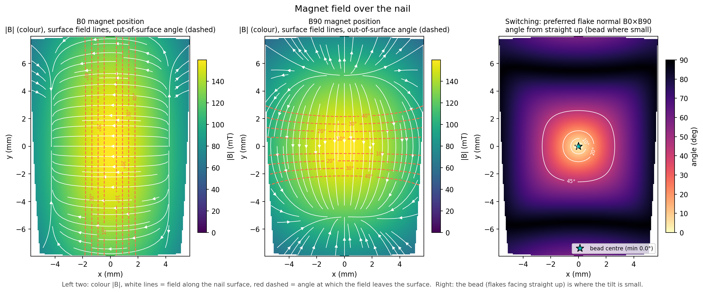
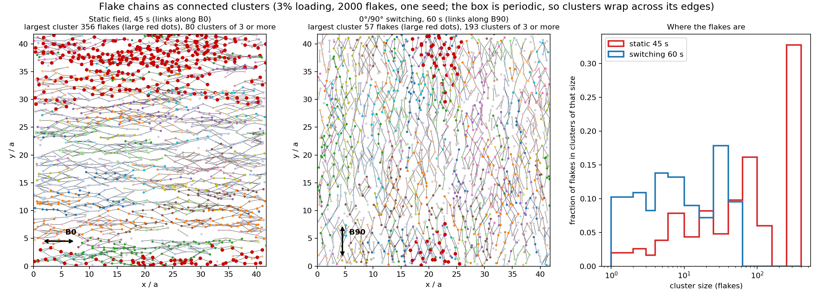
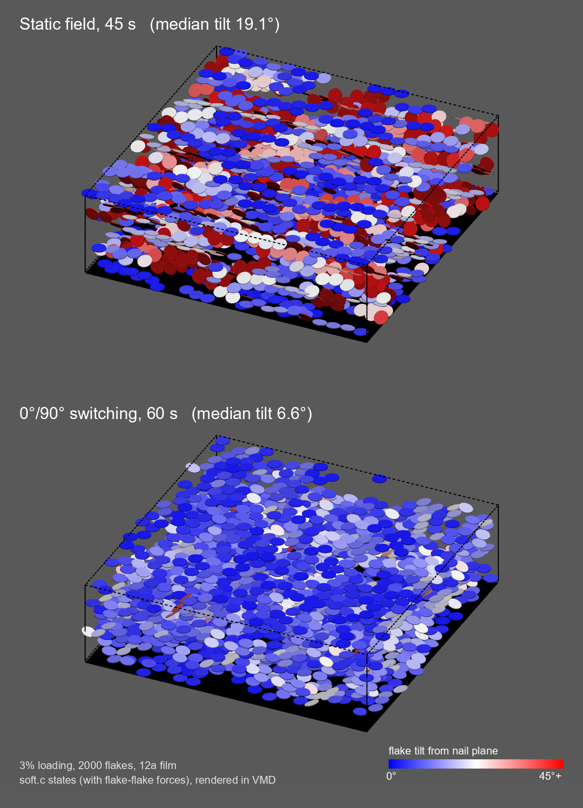
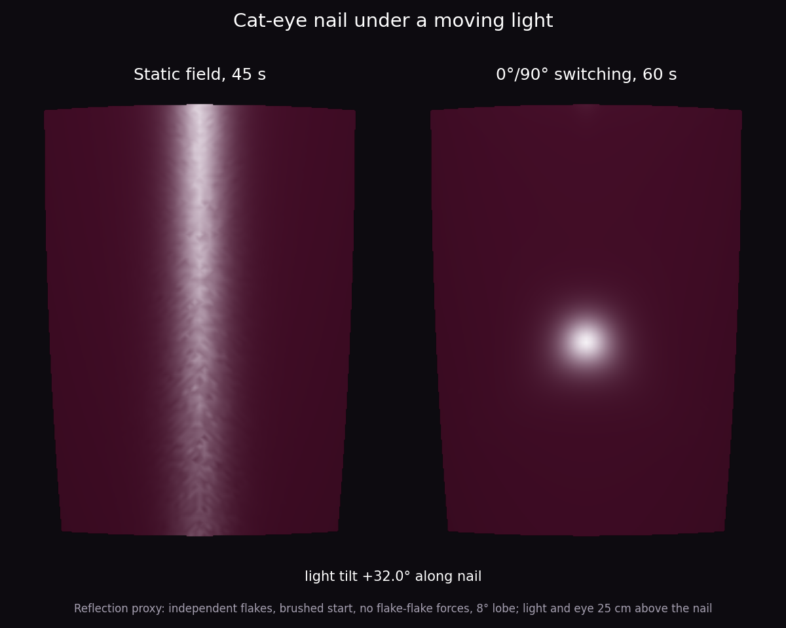

# CSCI 596 final project: platelet flakes in magnetic nail polish

Team: Vinayak Tiwari, Shreeya Halwasia, Ishita Joshi (USC CSCI 596, Fall 2026).

## What this is
A particle-level simulation of magnetic platelet flakes in viscous polish, driven by a magnetic field solver and
parallelized on USC Discovery. The question: does giving each flake a full orientation (a platelet, not a rod)
reproduce the compact bright bead that real users get by turning the magnet 90 degrees, which the existing
rod model cannot? A second question is whether flake-flake contact changes the result, which would also give
the parallel code real communication to do.

## What existed before the course, and what is new
- **Before the course (Aug 2026): the baseline simulator.** Magnetic field solver, rod-based flake model with
  viscosity thickening, 3D viewer, tests. Not part of this repository.
  Live: https://vinayaktiwariug20.github.io/magnetic-lacquer/ and code: https://github.com/vinayaktiwariug20/magnetic-lacquer
- **New for the course (this repository, from Oct 2026):** platelet orientation model, contact detection,
  parallelization (OpenMP, MPI), validation against the baseline and nail photos, scaling study.

## Contents
- `PLAN.md`: project plan, roles, timeline, risks, and the results of the first feasibility tests.
- `spike/platelet_spike.py`: Python feasibility test, rod vs platelet under 0 then 90 degree magnet switching.
  Result: `spike/platelet_spike.png` (rod gives a band, platelet gives a compact central patch).
- `spike/contact_spike.py`: overlap counts for randomly placed oriented thin discs at 1 to 10 percent loading.
  Result: `spike/contact_spike_result.json`.
- `spike/fields.json`: magnetic field at every nail point, exported from the baseline simulator.

## Run the spikes
    cd spike
    python platelet_spike.py fields.json 300    # needs numpy, matplotlib
    python contact_spike.py fields.json 300     # needs numpy

## Start here (team, Oct 28)
Question now: do magnetic forces between flakes explain the loading effect measured in real polish (alignment
degrades above about 5 vol%, Pereira et al. 2017), which contact alone does not reproduce? Roles are in `PLAN.md`.
The dated sections below are the log of results so far; the last few matter most.

Build and run the main model (gcc with OpenMP; on Windows use Git Bash or MSYS2, on Discovery `module load gcc`):

    cd c
    gcc -O2 -fopenmp -Wall soft.c -o soft -lm
    python center_field.py ../spike/fields.json field_3152.txt 300 3152    # field at one nail point (centre)
    ./soft field_3152.txt 0.03 5000 free 1 12             # 3% loading, 5000 flakes, contact, 12a film
    ./soft field_3152.txt 0.10 5000 free 1 12 4 5 10      # + film field (chi_in 4), static 5 s hold, brushed start

Arguments: field file, volume fraction, number of flakes, `ideal` (no contact) / `fixed` / `free` (sliding
contact), seed, film thickness in flake radii (0 = periodic cube), chi_in (film field, 0 = off), static hold in s
(0 = 0/90 switching), start spread in degrees (-1 = random start), flake state file (`-` = none), flake-flake
force cutoff in a (0 = off; needs `free` and chi_in > 0). Lengths are in flake radii a = 6 um.

Where things live in `c/soft.c`:
- `rk4` / `rhs`: magnetic torque on one flake (dn/dt = -kappa (B.n)(B - (B.n) n)).
- `dipole_rates`: forces and torques between flakes (rim-charge model, preliminary version; this
  is the loop to speed up and split across MPI ranks).
- `build_cells`, `nb_cell`, `cell_of`: cell lists (cell side 2a + H); `dipole_rates` scans as many cells as the
  cutoff needs. The same neighbour loop is what an MPI version splits across ranks (ghost layers, as in
  assignments 4 and 5).
- `sweep`, `apply_push`, `mobility`: contact resolution (projection, Jacobi sweeps). Flake mobilities in
  `mobility` also convert a magnetic force or torque into motion.
- Each flake updates only itself from neighbours' old state, so OpenMP needs no locks and results do not
  depend on thread count; keep that property.

For the visualisation: `soft` currently prints summaries only. Writing flake positions and normals to a file
(for rendering a BRDF lobe per nail point) is a small addition; ask Vinayak or open an issue.

## C port (Oct 24)

`c/platelet.c` is the platelet orientation model in C (RK4, same protocol as `spike/platelet_spike.py`), with an OpenMP loop over nail texels.

    cd c
    python export_inputs.py ../spike/fields.json inputs.bin
    gcc -O2 -fopenmp -o platelet_omp platelet.c -lm
    OMP_NUM_THREADS=8 ./platelet_omp inputs.bin out.bin
    python compare.py out.bin ../spike/platelet_spike_maps.npz

Check: matches the Python spike to 1e-14 (6305 texels x 8 flakes). Laptop timing, 8 cores: 6.24 s (1 thread), 0.88 s (8 threads), 7.1x. This is the embarrassingly parallel floor; flake-flake contact is the next step.

## Contact count in C (Oct 26)

`c/contact.c` is the disc-disc overlap test from `spike/contact_spike.py` with a cell-list neighbour search and an OpenMP loop over flakes (each flake counts its own partners, so no write races).

    cd c
    gcc -O2 -fopenmp -o contact contact.c -lm
    python contact_ref.py 4000 0.05 random in.bin ref.bin    # Python reference using the spike's own function
    ./contact file in.bin out.bin && python contact_check.py out.bin ref.bin
    OMP_NUM_THREADS=8 ./contact gen 2000000 0.05 1           # large random run

Checks:
- Identical per-flake counts to the Python spike for random and nearly aligned flakes at 1, 5 and 10% volume fraction (4000 flakes each).
- 2 million random flakes at 5%: 1.5715 overlaps per flake vs excluded-volume theory phi*pi*a/h = 1.5708.

Laptop timing, 2 million flakes: 16.1 s (1 thread), 8.6 s (2), 4.8 s (4), 3.1 s (8), 5.3x. Flakes are not sorted by cell yet, so memory access is scattered; sorting is the obvious next optimisation.

## Contact dynamics: upper bound (Oct 26)

`c/dynamics.c`: flakes at fixed random positions (overlap-free start), all in the field of the nail-centre texel, run through the switching protocol (5 s at 0 deg, 5 s at 90 deg, x6). Mode `ideal` ignores contact. Mode `hard` accepts a rotation step only if it creates no overlap (tries full, half, quarter step). Positions never move, so blocked flakes cannot slide away; `hard` is an upper bound on the effect of contact and `ideal` the lower bound.

    cd c
    python center_field.py ../spike/fields.json field_center.txt
    gcc -O2 -fopenmp -o dynamics dynamics.c -lm
    ./dynamics field_center.txt 0.03 20000 hard 1

Mean flatness (n.N)^2 at the nail centre, 20000 flakes (1 = all mirror-like; geometric limit here is 1.000):

| volume fraction | ideal, end | hard, end | full steps blocked |
|---|---|---|---|
| 1% | 1.000 | 0.962 | 6.9% |
| 3% | 1.000 | 0.873 | 22% |
| 10% | 1.000 | 0.593 | 66% |

Checks: identical output on 1 and 8 threads; no overlaps at the end of any hard run; halving dt twice moves 3% from 0.873 to 0.857 and 10% from 0.593 to 0.583; 80000 flakes or another seed change the result by at most 0.004.

Reading: if flakes could not move at all, contact would cost about 13% of the shine at 3% loading and 40% at 10%. The real effect is somewhere between this and zero; letting flakes translate (overdamped contact forces) is what narrows it. Bulk periodic box only, no nail surface or film walls yet.

## Contact with sliding flakes (Oct 27)

`c/soft.c`: same setup as `dynamics.c`, but flakes may also translate. Each flake is a "spherodisc" (points within H/2 of a zero-thickness disc). Each step: free magnetic rotation (RK4), then Jacobi projection sweeps that push overlapping pairs apart along the closest-point direction, split between the two flakes by viscous disc mobilities (16 eta a face-on, 32/3 eta a edge-on, 32/3 eta a^3 rotation). Flakes that tunnel through a neighbour within one step return to their start-of-step state. No stiffness parameter; dt = 0.01 s.

    cd c
    gcc -O2 -fopenmp -o soft soft.c -lm
    ./soft field_center.txt 0.03 5000 free 1      # modes: ideal | fixed | free

Mean flatness at the nail centre at the end of the protocol (5000 flakes; no contact gives 1.000):

| volume fraction | rejection, frozen (dynamics.c) | projection, frozen | projection, sliding |
|---|---|---|---|
| 3% | 0.880 | 0.913 | 0.998 |
| 10% | 0.593 | 0.637 | 0.993 |

Checks: `ideal` mode at dt = 0.05 reproduces dynamics.c exactly (0.499 after hold 1, 1.000 at end); halving dt moves the 3% sliding result from 0.998 to 1.000. Sliding runs converge (3%: every step; 10%: 49 of 6000 steps leave a residual penetration of at most 0.05 H); 0.5% (3%) and 1.6% (10%) of flake-steps are reverted. Mean displacement over the run: 0.13 a (3%), 0.44 a (10%). Frozen projection never fully converges (rotation alone cannot separate some pairs), so it is only a rough cross-check of the rejection bound.

Reading: in the bulk, contact barely changes the final alignment even at 10% loading, because flakes slide a fraction of a radius out of each other's way. The large loss in the frozen bound comes from pinning, not from contact as such. In overdamped dynamics viscosity sets the time scale of both magnetic and contact motion, so it does not change this comparison, only how far flakes get within a hold. Open: the nail surface (a wall that blocks sliding), larger boxes, and performance (10%: 600 s for 5000 flakes on 8 threads, dominated by the disc-distance search).

Box-size check (Oct 27): 10% sliding with 20000 flakes and another seed gives 0.478 after hold 1 and 0.993 at the end (5000 flakes: 0.479 and 0.993), mean shift 0.44 a, 1.5% reverted flake-steps; 1384 s on 8 threads.

## Nail surface and film top (Oct 27)

`soft.c` takes an optional film thickness (in flake radii): the box is then periodic sideways and bounded by a wall at the nail (z = 0) and one at the film top (z = Lz). A flake keeps its lowest (highest) rim point H/2 from a wall; walls join the projection sweeps but do not move. Without the argument the cube runs reproduce the previous results exactly (3%: 0.493 after hold 1, 0.998 at end, same crossing count).

    ./soft field_center.txt 0.03 5000 free 1 12      # 12a = 72 um film

Flatness by height above the nail, 12a film, 5000 sliding flakes, nail centre:

| loading | after hold 1: 0-2a / middle / 10-12a | end: all bands | end: mean |
|---|---|---|---|
| 0.1% (walls only) | 0.558 / 0.49-0.50 / 0.546 | 0.999-1.000 | 1.000 |
| 3% | 0.564 / 0.49 / 0.560 | 0.995-1.000 | 0.998 |
| 10% | 0.609 / 0.46-0.52 / 0.594 | 0.988-0.997 | 0.994 |

Reading: the walls do not stop alignment at the nail centre. Steeply tilted flakes cannot sit within one radius of a wall, so the wall layers hold fewer, flatter flakes (0.1%: 549 flakes in 0-2a vs about 950 per middle band) and start ahead; by the end every band is flat. This is expected here because the target orientation at the centre (n along B0 x B90) is parallel to the nail, which a wall never blocks. Off-centre texels, where the target is tilted, are the case where a wall could matter; that needs the wall tilted relative to the box (the code now refuses a nail normal that is not along z).

## Across the nail (Oct 27)

`soft.c` now rotates the fields so the local nail normal is z (Rodrigues; the stored normal is renormalised first), so wall runs work at any texel. `c/scan_line.py` runs, per texel: no contact, walls only (0.1%), and 3% and 10% with walls (12a film, 5000 sliding flakes); results in `c/scan_x.csv`. Seven texels from the centre (3152) to where the target orientation stands on edge (3128); the map is symmetric about the centre.

    python scan_line.py scan_x.csv 3152 3148 3144 3140 3136 3132 3128

| texel | geometric limit | end: none / walls / 3% / 10% | after hold 1: none / 10% |
|---|---|---|---|
| 3152 (centre) | 1.000 | 1.000 / 1.000 / 0.998 / 0.994 | 0.499 / 0.521 |
| 3148 | 0.919 | 0.919 / 0.919 / 0.917 / 0.916 | 0.457 / 0.484 |
| 3144 | 0.708 | 0.708 / 0.708 / 0.706 / 0.707 | 0.351 / 0.381 |
| 3140 | 0.442 | 0.442 / 0.442 / 0.441 / 0.442 | 0.219 / 0.244 |
| 3136 | 0.203 | 0.203 / 0.203 / 0.203 / 0.203 | 0.100 / 0.122 |
| 3132 | 0.048 | 0.048 / 0.048 / 0.049 / 0.049 | 0.024 / 0.045 |
| 3128 | 0.000 | 0.000 / 0.000 / 0.001 / 0.001 | 0.000 / 0.021 |

Reading: after six switching cycles every texel sits on its geometric limit (n along B0 x B90) to within 0.006, with or without contact and walls, nail band included. So in this model the converged bead shape is set by field geometry alone. (Corrected Oct 28: an earlier version said contact raises flatness after the first hold by 0.02 to 0.03. That compared runs with different starting states: inserting flakes between walls makes them start flatter at higher loading. With the same start, the first-hold difference vanishes as dt goes to 0; see "Static magnet" below.)

## Flakes' own magnetic field: estimate (Oct 27)

`c/dipole_estimate.py` (no dynamics). Linear flakes, chi_in 4 / chi_perp 1 (model dchi = 3) and a stronger bracket chi_in 8.

1. Film field. The magnetised layer is a thin sheet, so inside it the field component along the nail normal drops by 1/(1 + chi_NN). This tilts B0 and B90 toward the nail and moves the geometric limit. End flatness, chi_in 4 (8):

| texel | 0% | 1% | 3% | 10% |
|---|---|---|---|---|
| 3152 | 1.000 | 1.000 | 1.000 | 1.000 |
| 3148 | 0.919 | 0.921 | 0.924 (0.925) | 0.934 (0.937) |
| 3144 | 0.708 | 0.715 (0.720) | 0.729 (0.740) | 0.768 (0.790) |
| 3140 | 0.442 | 0.455 (0.465) | 0.479 (0.504) | 0.547 (0.601) |
| 3136 | 0.203 | 0.214 (0.224) | 0.235 (0.263) | 0.303 (0.375) |
| 3132 | 0.048 | 0.052 (0.055) | 0.059 (0.071) | 0.087 (0.129) |

2. Neighbour field. Non-overlapping flakes at the centre texel, each a rim of magnetic charge, cutoff 6a. Typical normal field from neighbours relative to |B| (median / 90th percentile): 1% 0.01-0.02 / 0.05-0.09, 3% 0.03-0.06 / 0.08-0.15, 10% 0.05-0.11 / 0.14-0.28. Flatness loss if each flake tilts by that much: at most 0.007 (chi_in 4) and 0.025 (chi_in 8) at 10%.

Reading: the largest effect is the film field, a first-order shift of the bead off-centre at 3-10% loading (0.20 to 0.30-0.38 at texel 3136). It needs no pair sums: it is a correction to the field. Neighbour fields tilt flakes by a few degrees, comparable to the contact transient. Not yet checked: dipole forces moving flakes into chains. Rough drift at 10% is about one radius over the full 60 s protocol, independent of viscosity (rotation and drift both scale as 1/eta).

## Film field in the dynamics (Oct 27)

`c/soft.c` takes an optional last argument `chi_in` (chi_perp = 1): at every step the field component along the nail normal is cut to B_z / (1 + chi_zz), with chi_zz = phi <chi_in (1 - nz^2) + nz^2> from the current flake orientations. Example: `./soft field_3136.txt 0.10 5000 free 1 12 4`.

- No contact (`ideal`, 2000 flakes, film 12a): end flatness at all 7 scan texels, phi 1/3/10%, chi_in 4 and 8, equals the self-consistent estimate of `dipole_estimate.py` to three decimals (e.g. texel 3136: 0.214/0.235/0.303 for chi_in 4, 0.224/0.263/0.375 for chi_in 8).
- With contact (`free`, 5000 flakes, texel 3136, chi_in 4): 3% end 0.235, 10% end 0.304. Contact again changes nothing at the end.

Reading: in this model, loading moves the bead through the film field alone; contact does not add to it. Literature notes are in PLAN.md.

## Static magnet and a time-step artifact (Oct 28)

`soft` arguments 8 and 9: one static hold in B0 (`static_hold_s`) and a start near the nail plane (`start_spread_deg`, -1 = random). Output: rms angle by which flake planes miss B0. Centre texel, film 12a, 5000 flakes, 5 s, contact (`free`), dt 0.01:

| loading | 1% | 3% | 5% | 8% | 10% | 13% |
|---|---|---|---|---|---|---|
| brushed start (10 deg), rms miss | 0.26 | 0.47 | 0.61 | 0.74 | 0.76 | 0.77 deg |
| random start, rms miss | 4.2 | 6.1 | 9.5 | 11.2 | 11.4 | 13.4 deg |

The random-start misalignment does not relax with longer holds (5, 15, 30 s identical), but it is a numerical artifact: about 7% of flakes per step rotate into a neighbour in one step, are sent back by the crossing backstop and never feel a contact push. At 10%: dt 0.01 / 0.005 / 0.0025 gives reverted flake-steps 7.1 / 3.0 / 1.5%, rms miss 11.4 / 7.6 / 5.7 deg, mean miss 2.78 / 1.24 / 0.71 deg (heading to 0). First-hold flatness with contact 0.521 / 0.530 / 0.533 against 0.533 without contact.

Reading: with a converged time step, sliding contact changes neither the first hold nor the end state. The switching results above were already dt-converged at the end (0.998 vs 1.000), so they stand. Contact therefore cannot explain the loading effect Pereira et al. measured, which leaves interactions between flakes (magnetic forces, chaining) as the candidate. For anything near contact, use dt 0.0025 or smaller, or add a per-step rotation limit (the rim of a flake should move less than about H/4 per step); this applies to the flake-force work too.

## Rotation limit with contact (Oct 28)

With contact, `soft` now splits each step into substeps so that no flake turns by more than MAXROT = 0.05 H/a (the rim moves at most H/20) per substep; the bound uses each flake's current magnetic rotation rate. Without contact nothing changes. Override at compile time with `-DMAXROT=(0.1*H/A)`.

Convergence at 10%, static 5 s, random start (rms / mean angle by which flake planes miss B0): no limit 11.4 / 2.78 deg; H/4 4.7 / 0.51; H/10 3.0 / 0.25; H/20 1.95 / 0.14. Both fall roughly in proportion to the limit, so what remains is still numerical and heads to 0.

Static sweep with the limit (centre, film 12a, 5000 flakes, 5 s, random start), rms miss: 1% 0.6, 3% 0.03, 5% 1.5, 8% 1.3, 10% 1.9, 13% 1.9 deg (mean at most 0.19 deg). First-hold flatness 0.51 to 0.54, as without contact.

Switching protocol check (3%, centre, film 12a): end 1.000, no crossings, 60 s on 8 threads (41 s before).

Reading: with sliding contact and a converged step, contact does not keep flakes from aligning in a static field at any loading up to 13%. The loading effect measured by Pereira et al. is not reproduced by contact.

## Flake state output (Oct 28)

`soft` takes the flake state file as argument 10 and writes it at the end of the run: `#` header lines (run settings, box, B0, B90 and nail normal in the simulation frame; with walls the frame is rotated so the local nail normal is +z), a column line, then one row per flake: `x,y,z,nx,ny,nz,kappa` (lengths in flake radii a = 6 um, thickness 0.1 a).

    ./soft field_3140.txt 0.03 2000 ideal 1 12 0 0 -1 flakes_3140.csv    # switching protocol, writes the file
    python read_flakes.py flakes_3140.csv                                # summary + flakes_3140.png

`read_flakes.py` has `load(path)` (header dict and an N x 7 array) for rendering or analysis, and a quick-look figure: flakes from above as projected ellipses coloured by tilt, and the normals in an equal-area projection about the nail normal. The spread of that normal cloud is what sets the width of the reflection lobe (Pereira et al. 2017, section 6).

## Forces between flakes: preliminary (Oct 28)

Argument 11 turns on magnetic forces and torques between flakes within a cutoff (centre distance, in a). Each flake is magnetised in its own plane, mu0 M = chi_in (B - (B.n) n), which for a thin disc puts magnetic charge on its rim; the rim is sampled with 16 charges, softened by H/2. Forces and torques become velocities and spin through the disc mobilities (v = kappa S (F - (F.n) n / 3), omega = kappa S T, S = 1/(pi H dchi)), added to the contact model. The rates are refreshed every 2 steps (0.02 s, `-DDIPEVERY`; the runs in the table below up to the convergence rows used 10). Checked against point dipoles at 10a (within 3%). The film field (argument 7) stays on as the uniform part of the flakes' own field, so the contribution of near neighbours is partly counted twice; to be sorted out.

Setup: centre of the nail (`field_3152.txt`), 2000 flakes, 12a film, chi_in 4, one static 5 s hold, random start unless noted. "Miss" is the angle between the flake plane and the applied field at the end (0 = fully aligned); "pairs along B" is <(d.b)^2> over pairs with centres closer than 2.2a (1/3 = no preferred direction, 1 = all pairs in line with the field, i.e. chains).

| run | miss mean / rms (deg) | pairs along B start -> end | wall (4-8 threads) |
|---|---|---|---|
| 10%, no forces | 0.20 / 2.62 | 0.340 -> 0.340 | 54 s |
| 10%, forces, cutoff 4a | 3.78 / 5.86 | 0.340 -> 0.383 | 187 s |
| same, rates every 5 steps | 4.25 / 6.47 | 0.340 -> 0.384 | 332 s |
| same, rates every 2 steps (new default) | 4.38 / 6.54 | 0.340 -> 0.383 | 247 s (8 threads) |
| same, rates every step | 4.34 / 6.64 | 0.340 -> 0.382 | 275 s (8 threads) |
| chi_in 8, no forces / forces (every 2 steps) | 0.20 / 2.62 vs 12.77 / 17.53 | 0.340 -> 0.389 | 52 / 721 s |
| same, dt 0.005 | 3.79 / 5.77 | 0.340 -> 0.382 | 303 s |
| same, cutoff 6a | 3.95 / 5.92 | 0.340 -> 0.381 | 283 s |
| seed 2, no forces / forces | 0.07 / 0.60 vs 3.89 / 5.56 | 0.342 -> 0.385 | 66 / 295 s |
| 3%, no forces / forces | 0.01 / 0.29 vs 3.24 / 5.14 | 0.337 -> 0.484 | 17 / 122 s |
| 1%, no forces / forces | 0.00 / 0.01 vs 1.98 / 3.86 | 0.341 -> 0.643 | 3 / 47 s |
| 10%, brushed start, no forces / forces | 0.00 / 0.15 vs 3.89 / 5.51 (flatness after hold 0.988 vs 0.941) | 0.328 -> 0.400 | 11 / 288 s |

Reading:
- Forces between flakes leave nearly every flake tilted a few degrees off the field (mean close to rms, so a broad shift rather than a few stuck flakes). Without forces the miss is at most 0.2 deg. Independent of the start (brushed or random) and of the seed, insensitive to dt and cutoff.
- Refresh interval: converged at every 2 steps (mean miss 4.38 deg vs 4.34 at every step); every 10 steps underestimates it by about 13%, so the other rows (10-step refresh) are low by about that much. The comparisons between them stand.
- The effect grows with loading (2.0, 3.2, 3.8 deg at 1, 3, 10%) but smoothly, with no threshold near 5 vol% as in Pereira et al.; most of it is already there at 1%.
- Close pairs line up along the field, most strongly at low loading (0.64 at 1%), the start of chains as seen by Le Ferrand and Arrieta (2022) at 1 vol%. At high loading neighbours are too crowded to rearrange in 5 s.
- The size of the effect depends strongly on chi_in, which is not measured for cosmetic flakes: doubling it from 4 to 8 triples the mean miss (4.4 to 12.8 deg; pair forces scale as chi_in^2, the aligning torque does not). At chi_in 8 the spread is large enough to matter for the reflection lobe. Pinning down chi_in (or a range) is now the main physics question. Real flakes are roughly square (Pereira et al. Figs. 9, 11); corners concentrate rim charge, so near-field forces may be stronger than for discs.
- Next: a chi_in range from flake composition, loading series at the new refresh interval, longer holds (do chains keep growing?), then hand `dipole_rates` to the MPI and scaling work.


## Flake susceptibility: range and tied model (Oct 28)

Correction to the chi_in 8 row above: those runs raised the pair forces (which go as chi_in^2) while keeping the aligning torque fixed (dchi = 3 in kappa0). Both come from the flake's own magnetisation: a thin flake of in-plane susceptibility chi_in has chi_perp = chi_in / (1 + chi_in) (demagnetised normal to its plane), so dchi = chi_in^2 / (1 + chi_in), and the ratio of pair torque to aligning torque grows only as 1 + chi_in. Build with `-DTIE_DCHI` to tie chi_perp and dchi to chi_in. kappa0 is left unchanged, which only rescales time, so runs with different chi_in are compared after the same number of alignment times.

Range of chi_in. Assumptions, not measurements: the magnetic layer is magnetite (the black iron oxide of magnetic polish, mu0 Ms about 0.6 T), and the flakes are built like typical pearlescent pigments (iron oxide 50-150 nm per side on 300-500 nm of mica, so 20-50% of the flake volume). In-plane the flake is not demagnetised, so at the 160 mT of the magnet its magnetisation is limited by saturation: mu0 M <= f * 0.6 T, so chi_in = mu0 M / B <= 3.75 f, about 0.5-2. A stronger magnet lowers it further. chi_in 4 is at the top of what pure magnetite flakes could give, and 8 is out of range.

Tied model, centre of the nail, 2000 flakes, 12a film, static 5 s, brushed start, cutoff 4a, rates every 2 steps:

| chi_in | 1 + chi_in | miss mean / rms (deg) | flatness after hold | pairs along B (start 0.33) |
|---|---|---|---|---|
| 0.5 | 1.5 | 1.51 / 2.19 | 0.974 | 0.378 |
| 1 | 2 | 1.96 / 2.89 | 0.966 | 0.384 |
| 2 | 3 | 2.90 / 4.27 | 0.951 | 0.393 |
| 4 | 5 | 4.53 / 6.38 | 0.923 | 0.403 |
| 8 | 9 | 7.02 / 9.85 | 0.881 | 0.406 |

(No forces: miss 0.00 / 0.15, flatness 0.988.) The mean miss grows roughly as (1 + chi_in)^0.8.

Loading at chi_in 1 (tied, brushed): mean miss 1.04, 1.53, 1.96 deg at 1, 3, 10%; pairs along B 0.53, 0.45, 0.38. At chi_in 4 (untied, random start, rates every 2 steps): 2.27, 3.65, 4.38 deg at 1, 3, 10%.

Reading: in the plausible range (chi_in 0.5-2) forces between flakes tilt them 1.5-3 deg off the field at 10% loading, about 1 deg at 1%. The reflection moves by twice the tilt, so 3-6 deg of extra lobe width at high loading. The growth with loading is smooth and does not show the threshold near 5 vol% that Pereira et al. report, so on present evidence neither contact nor pair forces alone explain it. Candidates left: magnetophoresis in the magnet's gradient (flakes drawn together and toward the nail), polish viscosity rising with loading, flake shape and size spread (squares, 5-60 um), and chaining over longer holds. Measuring chi_in of a real flake (e.g. alignment speed of a single flake under a known field) would remove the main uncertainty.

## Magnet pull and chains over longer holds (Oct 29)

Magnet pull (magnetophoresis), estimate. A flake's moment in the magnet's gradient (B = 160 mT falling off over L = 2-10 mm) drifts it 4-36 nm per alignment time 1/(kappa B^2), for chi_in 0.5-2; the viscosity cancels in this ratio. How many alignment times a coat sees depends on the viscosity: in UV gel (300 Pa s) alignment takes about a second and the drift over a 10 s hold is negligible; in thin polish (about 1 Pa s) alignment takes milliseconds and a 10 s hold can move flakes tens of um toward the magnet, comparable to the film thickness. It moves all flakes alike, so its main effect would be to pack them toward one side (higher local loading), not to tilt them. Not modelled.

Chains over longer holds. Tied model, chi_in 1, brushed start, 2000 flakes, 12a film, cutoff 4a. Time here is in the kappa0 units of the other runs (1 s = 6 alignment times at 160 mT); real time is shorter in thin polish and longer in gel. `chains.py` links flakes whose centres are closer than 2.2a and whose pair line is within 37 deg of the field, and counts connected chains.

### Reproducibility of the 3% visualisation states

The 3% static and switching states used for the final visualisations were regenerated from commit `1e9b6d8` on USC Discovery. Both runs used seed `1`, `OMP_NUM_THREADS=8`, 2000 flakes, a 12a film, `chi_in=1`, a 10 deg brushed start, and a 4a force cutoff. These regenerated values are the canonical values used in the tables, figures, and slides.

```bash
# Run from the repository root
RUNS="../csci596-magnetic-polish-runs/reproduction"
mkdir -p "$RUNS"
module purge
module load ver/2607
module load gcc/15.3.0
export OMP_NUM_THREADS=8
gcc -O2 -fopenmp -Wall -DTIE_DCHI c/soft.c -o $RUNS/soft_tied -lm
$RUNS/soft_tied c/field_center.txt 0.03 2000 free 1 12 1 45 10 $RUNS/static_3pct_45s.csv 4
$RUNS/soft_tied c/field_center.txt 0.03 2000 free 1 12 1 0 10 $RUNS/switching_3pct_60s.csv 4
```

For switching, chain statistics are evaluated separately along B0 and B90. `c/chains_field.py` uses the same 2.2a distance and 37 deg angular criteria as `chains.py`, but allows the field direction to be selected instead of assuming B0.

| loading, hold | flatness | miss mean (deg) | links/flake | mean chain (per flake) | longest |
|---|---|---|---|---|---|
| 1%, no forces 5 s | 0.988 | 0.00 | 0.14 | 1.4 | 5 |
| 1%, 45 s | 0.785 | 1.68 | 0.76 | 6.5 | 29 |
| 3%, no forces 45 s | 0.986 | 0.00 | 0.37 | 2.6 | 13 |
| 3%, 5 s | 0.971 | 1.53 | 0.74 | 9.6 | 47 |
| 3%, 15 s | 0.900 | 1.89 | 1.00 | 37 | 139 |
| 3%, 45 s | 0.736 | 1.88 | 1.206 | 138.3 | 356 |
| 10%, no forces 5 s | 0.988 | 0.00 | 1.27 | (percolates by contact) | |
| 10%, 5 s | 0.966 | 1.96 | 1.80 | | |
| 10%, 45 s | 0.864 | 2.14 | 2.27 | | |

Only the 3%, 45 s row with forces was regenerated for the final visualisations; the other rows are from earlier runs.

Reading:
- Chains form and keep growing along the field: at 3% the mean chain grows from about 10 to 138 flakes between 5 and 45 s, and the regenerated 45 s state has a largest connected chain of 356 flakes. These are branched clusters rather than single lines and are already limited by the box size. At 10% the flakes are close enough that the count saturates; links per flake still rise.
- The flake planes stay within about 2 deg of the field, but the flakes turn about the field axis, away from the nail plane: flatness falls from 0.97 to 0.74 at 3% over 45 s, with no forces it stays at 0.99. A static field leaves that rotation free (a flake containing B feels no torque about B), and the pair forces inside chains drive it. In `chains_03_45.png` the normals spread along one line (a stripe-shaped reflection lobe, broadened across the field), not into a disc.
- This is the largest effect of flake-flake forces found so far, and it grows with time rather than with loading: the loss is largest at 3% (0.74), then 1% (0.79), then 10% (0.86), where crowding hinders rotation. A loading threshold would need a further ingredient; a hold-time dependence is a prediction that could be checked against photos of real nails held under the magnet for different times.
- Open: convergence of the long runs (one seed, 2000 flakes in a box the longest chains already wrap), whether rotating or switching fields (the 0/90 protocol pins the rotation about B) suppress it, and whether it survives with a larger chi_in.

## 0/90 switching with flake-flake forces (Nov 2)

Same settings as the long holds above (tied model, chi_in 1, 3%, brushed start, 2000 flakes, 12a film, cutoff 4a), but the switching protocol instead of a static hold: 6 cycles of 5 s at 0 deg and 5 s at 90 deg, 60 s in all. The run ends in the 90 deg phase, so chains are counted along both fields (`chains.py` uses B0; along B90 the same rule with B90).

| run | flatness | links/flake | mean chain (per flake) | longest |
|---|---|---|---|---|
| static 45 s, forces (from above) | 0.736 | 1.206 | 138.3 | 356 |
| switching 60 s, no forces | 1.000 | 0.37 / 0.40 | 2.6 / 2.9 | 13 / 16 |
| switching 60 s, forces | 0.964 | 0.651 / 0.811 | 9.1 / 15.1 | 59 / 57 |

(pairs of numbers: along B0 / along B90)

Reading:
- Switching suppresses the loss almost completely: after 60 s the regenerated state has flatness 0.964, against 0.736 after 45 s of static field, and remains close to what a single 5 s static hold gives (0.971). The forces still cost about 0.04 against the no-force run (1.000), uniformly through the film depth.
- Chains still form, with greater connectivity along the current B90 phase (mean chain 15.1 along B90 versus 9.1 along B0), but stay much smaller than under the static field (138.3): each switch turns the field by 90 deg and disrupts chains built along the previous direction.
- Mechanism: in a static field a flake containing B is free to turn about B, and pair forces inside chains drive that turn. Under 0/90 switching the only orientation that contains both fields is the nail plane, so every phase pulls the flakes back toward it. This is why the cat-eye protocol is robust to flake-flake forces, and it means the large flatness loss found above is specific to a static magnet.
- Loading series, same protocol (flatness at start / end; chains along B90):

| loading | start | end, no forces | end, forces | mean chain, forces | longest |
|---|---|---|---|---|---|
| 1% | 0.971 | 1.000 | 0.976 | 2.3 | 15 |
| 3% | 0.971 | 1.000 | 0.964 | 15.1 | 57 |
| 10% | 0.975 | 1.000 | 0.979 | (percolates by contact) | |

- With forces the bead barely sharpens from the brushed start (about 10 deg rms; +0.005 at 1%, +0.004 at 10%, -0.007 at 3%): switching holds the flakes near the shared orientation but the pair forces keep them from closing in on it. The blur is about 0.02-0.04 in flatness at every loading and is not monotonic in it (largest at 3%, as under a static field, where crowding at 10% hinders rotation). So flake-flake forces do not explain a loading effect under switching (one seed per loading). They do predict that a static magnet gives a worse, stripe-shaped reflection than switching under the protocols tested here.

## Thinner flakes: crowding under a static magnet (Nov 2)

Pereira et al.'s loading test used a static bar magnet, so this goes back to the static case. Crowding depends on loading times aspect ratio: thin discs can no longer sit at random orientations above a number density of about rho D^3 = 4 (isotropic-nematic, Eppenga and Frenkel 1984), which is phi = 1.6 h/a. That is 16 vol% for our a/h = 10, but 4 vol% for a/h = 40, close to Pereira's threshold of about 5 vol%; real pigments (10-60 um across, about 0.3-0.5 um thick) span a/h of about 10-100. The thickness is now a compile-time option (`-DH=0.025` for a/h = 40; default 0.1). Centre texel, film 12a, 2000 flakes, contact only (no film field, no flake-flake forces), static 5 s, random start (flakes stirred into gel). kappa0 is unchanged, which only rescales time.

Angle by which flake planes miss B0 after 5 s, mean / rms (deg):

| a/h | 1% | 3% | 5% | 10% |
|---|---|---|---|---|
| 10 | 0.00 / 0.01 | 0.01 / 0.29 | 0.06 / 1.50 | 0.20 / 2.62 |
| 20 | 0.00 / 0.02 | 0.08 / 1.94 | 0.11 / 2.01 | 0.11 / 0.50 |
| 40 | 0.00 / 0.06 | 0.09 / 1.52 | 0.19 / 2.38 | insertion jams (1333 of 2000) |

(A brushed start aligns trivially at the centre: the field lies in the nail plane, which flat flakes already contain; rms miss at most 0.35 deg for all cases.)

Reading:
- Crowding does not stop alignment in this model, even past the crowding point (a/h 20 at 10% and a/h 40 at 5% are both at phi a/h = 2): the mean miss stays below 0.2 deg everywhere, and the rms of 1.5-2.6 deg comes from a few flakes, the size of the residual the rotation limit leaves (see "Rotation limit with contact").
- What crowding does do is forbid the random start: at a/h 40 and 10% the flakes cannot be placed at random orientations at all. A real coat at that loading would already be in locally parallel stacks before the magnet is applied.
- So a thinner flake alone does not give Pereira's threshold. Our contact is frictionless and the medium purely viscous, so sliding flakes always find a way past each other. Friction between flakes, a gel yield stress, or stacks that have to turn as a whole are the remaining crowding mechanisms; squares (corner contacts) belong with these.

## Friction between flakes (Nov 3)

Coulomb friction in the contact projection, compile-time `-DMU=0.5` (default 0, byte-identical to before): at each flake-flake contact the sliding of the two contact points since the start of the substep is undone, up to MU times that sweep's normal correction (stick below, slip above). Spin about the flake normal is not modelled, so friction acts on translation and tilting only; walls stay frictionless. Same test as above (centre, film 12a, 2000 flakes, contact only, static 5 s, random start). a/h 40 ran on Discovery (job 13699258, 8 cores each).

Mean angle by which flake planes miss B0 (deg), rms in brackets:

| a/h, loading | mu 0 | mu 0.5 | mu 1.0 |
|---|---|---|---|
| 10, 1% | 0.00 | 0.00 | 0.00 |
| 10, 3% | 0.01 | 0.01 | 0.02 |
| 10, 5% | 0.06 (1.50) | 0.08 (1.50) | 0.08 (1.51) |
| 10, 10% | 0.20 (2.62) | 0.44 (2.79) | 0.61 (3.00) |
| 40, 1% | 0.00 | 0.01 | |
| 40, 3% | 0.09 (1.52) | 0.27 (1.71) | 0.32 (1.76) |
| 40, 5% | 0.19 (2.38) | 0.57 (2.73) | 0.91 (2.74) |

Reading:
- Friction makes crowded flakes align worse, and more so for thin flakes: at a/h 40 and 5% the mean miss rises from 0.19 to 0.91 deg with mu 1. The effect follows loading times aspect ratio (a/h 40 at 5% is about a/h 10 at 10% or more), as expected for crowding.
- It still rises smoothly with loading, with no jump near 5 vol%, and stays below 1 deg on average after 5 s: a sub-degree broadening of the lobe, not the clear widening Pereira et al. report. Not checked: whether it relaxes with longer holds (then friction only slows alignment) or stays (then flakes are jammed).
- Summary of the loading question so far: contact, thinner flakes, friction, flake-flake magnetic forces and switching all leave alignment within about 1 deg up to 10%, except the slow chain-driven rotation under long static holds. The loading effect in real polish most likely needs something outside this model: polydisperse and irregular flakes (10-60 um, square), a gel that resists slow flow, or the coat's own drying flows.

## Static vs switching visualisation (Nov 19)

Regenerated 3% states from Discovery: 2000 flakes,
12a film, tied model, chi_in 1, seed 1, brushed start,
cutoff 4a.

`visualization/compare_states.py` plots the flake centres
on the nail plane, coloured by tilt, with chain links
along B0 or B90. Links crossing the periodic boundaries
are counted but not drawn. The lower panels show Lambert
equal-area projections of the flake normals. Flatness
is the mean squared normal component along z.

| run | flatness | median tilt (deg) | links/flake | mean chain (per flake) | longest |
|---|---|---|---|---|---|
| static 45 s, B0 | 0.736 | 19.1 | 1.206 | 138.3 | 356 |
| switching 60 s, B90 | 0.964 | 6.6 | 0.811 | 15.1 | 57 |

Reading:

- Under the static field the normals spread along one
  direction, consistent with rotation about B0.
- Switching keeps the normals closer to the nail normal.
  Median tilt falls from 19.1 to 6.6 deg, and mean chain
  size from 138.3 to 15.1 flakes.
- These are single-seed runs in a finite box, with
  different hold times (45 and 60 s).

Run locally using the saved states
(requires numpy, scipy and matplotlib):

    RUNS="results/visualization"
    python visualization/compare_states.py "$RUNS/static_3pct_45s.csv" "$RUNS/switching_3pct_60s.csv" --output "$RUNS/static_vs_switching_final.png"



## Optical reflection proxy (Nov 19)

`visualization/render_brdf.py` evolves independent platelet normals
at each nail point in `spike/fields.json`. The main figures now use
a 10 deg rms brushed start, matching the initial orientation used
in the Discovery runs. The original random 3D start is retained
with `--start random`.

Other settings: a = 6 um, h/a = 0.1, dchi = 3, eta = 300,
seed 1, log-normal rate spread 0.55, RK4 with dt = 0.05 s,
32 flakes per point.

For a normal n and half-vector H = (0,0,1), the reflection
contribution is exp(-theta/w), where theta = acos(|n.H|)
and w is the angular width. Contributions are averaged per
nail point, and the static and switching panels share a
maximum for normalisation.

Static 45 s vs six cycles of 5 s B0 and 5 s B90,
with a brushed start:

| width (deg) | static peak | switching peak | static mean | switching mean |
|---|---|---|---|---|
| 4 | 0.466 | 1.000 | 0.018 | 0.002 |
| 8 | 0.626 | 1.000 | 0.052 | 0.007 |
| 12 | 0.714 | 1.000 | 0.091 | 0.017 |

Reading:

- The static field gives a narrow cat-eye stripe, while switching
  gives a compact bright patch. Both patterns persist at all
  three reflection widths.
- The brushed start makes the static stripe brighter. At 8 deg
  its peak rises from 0.197 with a random start to 0.626 with
  a brushed start.
- Switching still has the higher peak, but the static stripe
  has the higher spatial mean.
- The random-start 8 deg run reproduces the earlier results:
  static peak 0.197, mean 0.011; switching peak 1.000,
  mean 0.007.
- This is a reflection proxy, not calibrated reflectance.
  The model uses independent flakes without flake-flake forces,
  unlike the interacting-particle Discovery runs. Each width
  is normalised separately, and the two protocols have
  different hold times.

Run locally:

    RUNS="results/visualization"
    for WIDTH in 4 8 12; do
        python visualization/render_brdf.py spike/fields.json --eta 300 --flakes 32 --start brushed --start-deg 10 --width-deg "$WIDTH" --output "$RUNS/brdf_width_${WIDTH}.png"
    done

For the original random-start comparison:

    python visualization/render_brdf.py spike/fields.json --eta 300 --flakes 32 --start random --width-deg 8 --output results/visualization/brdf_width_8_random.png

Brushed-start maps: [4 deg](results/visualization/brdf_width_4.png),
[8 deg](results/visualization/brdf_width_8.png),
[12 deg](results/visualization/brdf_width_12.png).

Random-start maps: [4 deg](results/visualization/brdf_width_4_random.png),
[8 deg](results/visualization/brdf_width_8_random.png),
[12 deg](results/visualization/brdf_width_12_random.png).



## More visualisations (Nov 20)

Five extra views of the same results. The optical ones (light sweep, time-lapse) use the independent-flake model of `render_brdf.py` above, so they include no flake-flake forces. The others use the regenerated 3% Discovery states.

| script | output | what it shows |
|---|---|---|
| `visualization/field_map.py` | `field_map.png` | B0 and B90 over the nail (\|B\| 65-160 mT, surface field lines, out-of-surface angle), and the angle of B0×B90 from vertical; the bead sits where that angle is small, at the nail centre |
| `visualization/chain_clusters.py` | `chain_clusters.png` | every connected chain cluster coloured separately, plus the fraction of flakes per cluster size; largest cluster 356 (static, along B0) vs 57 (switching, along B90) |
| `visualization/flakes_vmd.py` | `flakes3d_pair.png` | the flakes as 3D discs in VMD, coloured by tilt (blue flat, red 45 deg or more) |
| `visualization/light_sweep.py` | `light_sweep.mp4`, `light_sweep_still.png` | the nail under a moving point light, light and eye 25 cm above; each nail point has its own half-vector, so the bead slides as the light tilts |
| `visualization/timelapse.py` | `timelapse.mp4` | 0-60 s from a brushed start (10 deg): flake normals at the nail centre (top) and the whole nail lit from overhead (bottom); static leaves a stripe, switching collapses to a bead within a few seconds of the first B90 phase |

Run locally from the repository root (numpy, scipy, matplotlib; ffmpeg for the videos; VMD for the 3D view). The time-lapse peaks at about 2 GB of memory.

    RUNS="results/visualization"
    python visualization/field_map.py spike/fields.json --out "$RUNS/field_map.png"
    python visualization/chain_clusters.py "$RUNS/static_3pct_45s.csv" "$RUNS/switching_3pct_60s.csv" --out "$RUNS/chain_clusters.png"
    python visualization/flakes_vmd.py "$RUNS/static_3pct_45s.csv" static.tcl --image static.tga --batch
    vmd -dispdev text -e static.tcl
    python visualization/light_sweep.py spike/fields.json --out "$RUNS/light_sweep.mp4" --still "$RUNS/light_sweep_still.png"
    python visualization/timelapse.py spike/fields.json --out "$RUNS/timelapse.mp4"

`flakes3d_pair.png` puts the static and switching VMD renders side by side with a tilt colour bar. On Windows, pass forward-slash paths to `--image` (Tcl drops backslashes).





